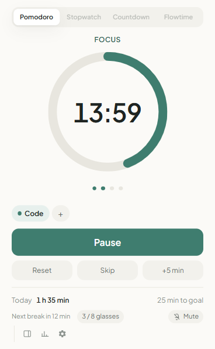
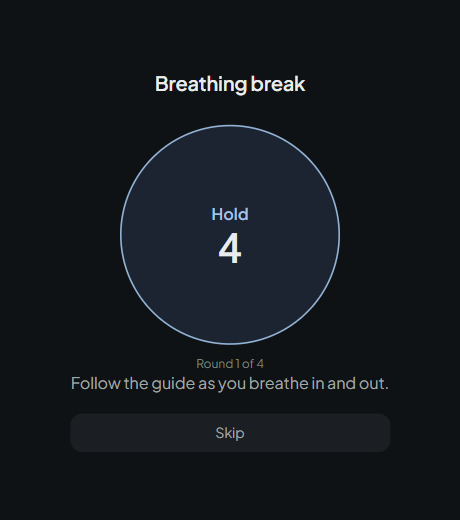
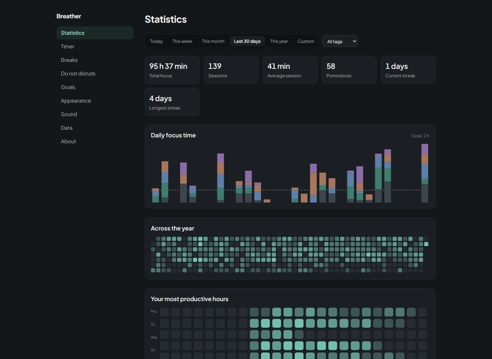
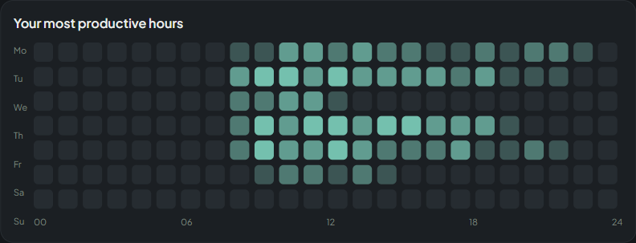

# Breather

A focus timer with health breaks, built as a Manifest V3 browser extension for
Chrome, Edge and Firefox from a single codebase.

No account, no server, no analytics — **the extension makes zero network
requests**, which you can verify yourself in DevTools.

[](https://github.com/mehmeterenyasar/breather/actions/workflows/ci.yml)


| Timer                                  | Break window                           |
| -------------------------------------- | -------------------------------------- |
|  |  |





<sub>Screenshots are produced by <a href="scripts/screenshots.mjs">a script</a>,
against the real extension running in Chromium, so they cannot drift from the
build.</sub>

---

## The interesting problem

In Manifest V3 the extension's background script is a **service worker that the
browser suspends at will** — typically after ~30 seconds of inactivity. That
breaks the obvious way to build a timer:

```js
// Wrong: dies the moment the service worker is suspended.
setInterval(() => (remaining -= 1000), 1000);
```

Timer extensions get this wrong in ways users notice: the countdown drifts, it
resets on browser restart, or it silently stops while the window is in the
background.

**Breather never stores a countdown.** The state is a set of timestamps:

```ts
interface TimerState {
  startedAt?: number; // epoch ms
  plannedMs?: number; // undefined = counting up (stopwatch)
  pausedTotalMs: number; // completed pauses
  extendedMs: number; // time added with "+5 min"
  // ...
}

remaining = plannedMs + extendedMs - (now - startedAt - pausedTotalMs);
```

Remaining time is **derived on every read** from `Date.now()`. Phase endings are
scheduled with `chrome.alarms` at absolute timestamps, and every alarm handler
re-reads state from storage rather than trusting anything held in worker memory.

The consequence is a function called `reconcile()`, which runs whenever the
worker wakes, the browser starts, or the machine resumes from sleep:

- Deadline not reached → nothing changes, the alarm is re-armed.
- Deadline passed → the session is closed with its **true** end time, not the
  moment we happened to notice.
- Noticed more than 90 seconds late (the browser was closed) → the auto-start
  chain is suppressed, because "your break started 10 minutes ago" is a lie.

All of it is covered by tests driving a fake clock, so scenarios like "browser
closed for ten minutes", "laptop slept" and "worker suspended" are verified in
milliseconds instead of by hand.

---

## Architecture

Two rules shape the codebase.

**1. `src/core/**` is pure.** No browser APIs, no `Date.now()` — `now` is always
a parameter. ESLint enforces both:

```js
{
  files: ['src/core/**/*.ts'],
  rules: {
    'no-restricted-syntax': [/* Date.now() is banned here */],
    'no-restricted-globals': [/* chrome, browser are banned here */],
  },
}
```

That rule is what makes the timer logic, break scheduling, do-not-disturb gates,
streak maths and midnight splitting testable without a browser at all.

**2. The UI never waits for the worker.** The popup reads settings, timer state
and today's summary straight from `storage` and renders immediately; commands
travel to the service worker as messages. A dedicated `local:todaySummary` cache
exists purely so the popup never has to touch IndexedDB.

```
src/
├─ core/        Pure logic — no browser APIs, no wall clock
├─ bg/          Service worker side: alarms, badge, notifications, audio, breaks
├─ storage/     Settings (sync), timer and break state (local), caches
├─ db/          IndexedDB via Dexie: sessions, break events, daily rollups
├─ i18n/        Runtime translation with compile-time key safety
├─ ui/          Shared Preact components and hand-written SVG charts
└─ entrypoints/ popup · options · side panel · break window · offscreen · background
```

### Other decisions worth a look

| Decision                                   | Why                                                                                                                                                                                                           |
| ------------------------------------------ | ------------------------------------------------------------------------------------------------------------------------------------------------------------------------------------------------------------- |
| **Materialised daily rollups**             | The statistics page reads a few rows per day instead of scanning sessions. With 5,000 sessions it renders in well under a second, and the table is fully derived — rebuildable from the sessions at any time. |
| **No chart library**                       | Four chart forms (stacked bars, two heatmaps, horizontal bars) are ~80 lines of SVG each, take their colours from CSS custom properties, and add 0 KB of dependencies.                                        |
| **No audio files**                         | The ten notification tones are synthesised with Web Audio from plain data, so there is nothing to license and nothing to download.                                                                            |
| **Offscreen document, closed immediately** | A service worker cannot play audio. The offscreen document is created for the tone and closed right after, rather than kept alive.                                                                            |
| **Break screen as its own window**         | No content script, no host permissions, nothing injected into the pages you visit.                                                                                                                            |
| **Build-time browser split**               | `import.meta.env.BROWSER` strips the offscreen code path from the Firefox bundle entirely; Firefox plays audio directly from its event page.                                                                  |

---

## Testing

```bash
npm run check
```

295 tests across five layers:

| Layer                 | What it proves                                                                                                                                                                                    |
| --------------------- | ------------------------------------------------------------------------------------------------------------------------------------------------------------------------------------------------- |
| **Pure core**         | Timer state transitions, pause arithmetic, reconciliation after sleep or restart, midnight and DST day splitting, streak rules, break scheduling and deferral, do-not-disturb gates, CSV escaping |
| **Storage**           | Settings migration and clamping, recovery from corrupt records                                                                                                                                    |
| **Database**          | Rollup correctness after edits and deletes, backup round-trip, a 5,000-session performance check                                                                                                  |
| **Background wiring** | Against a fake browser: alarms armed at the right timestamps, sessions written with the right end time, badge and break windows driven correctly                                                  |
| **UI**                | Popup, every settings section, onboarding and the break window rendered in a real DOM, plus a CSS contract test asserting every `var(--token)` is defined                                         |

Three of those suites were written in response to a bug, and each caught it:

- The Pomodoro cycle counter was wiped whenever the timer went idle.
- A notification or audio failure aborted the entire timer transition.
- `--tone` colour tokens were only defined under `[data-phase]`, so every solid
  button and every "on" switch in the settings page rendered transparent.

---

## Stack

TypeScript (strict) · [WXT](https://wxt.dev) · Preact · Dexie · Vitest ·
plain CSS with design tokens

Preact and hand-written CSS keep the popup bundle at roughly 18 KB so it opens
instantly. The typeface (Plus Jakarta Sans, OFL) is bundled, never fetched.

### Internationalisation

Six languages: English (default), German, Spanish, French, Brazilian
Portuguese and Turkish.

`browser.i18n` takes the language from the browser and cannot be switched at
runtime, so translations are JavaScript catalogs instead. English is the source
of truth and every other catalog has to match its shape — a missing key is a
compile error, and placeholder names are checked at the type level:

```ts
i18n.t('action.extend'); // ✗ requires substitutions
i18n.t('action.extend', { minute: 5 }); // ✗ unknown field 'minute'
i18n.t('action.extend', { minutes: 5 }); // ✓ "+5 min"
```

Non-default languages are lazy-loaded, so the popup only ever ships English.

---

## Running it

```bash
npm install
```

```bash
npm run verify
```

Then load `.output/chrome-mv3` as an unpacked extension from
`chrome://extensions` with developer mode enabled.

| Command                               |                                                                    |
| ------------------------------------- | ------------------------------------------------------------------ |
| `npm run verify`                      | Type-check, lint, test, then build for Chrome                      |
| `npm run dev`                         | Dev server with hot reload                                         |
| `npm run build:chrome\|edge\|firefox` | Production build for one browser                                   |
| `npm run zip`                         | Store packages for all three, plus the source archive AMO requires |

Node 22.12+ is recommended; it also runs on 20.

A step-by-step manual test guide covering the acceptance scenarios is in
[TEST.md](TEST.md) (Turkish).

---

## Privacy

No network requests, no analytics, no accounts, no content scripts, no host
permissions. Settings travel through the browser's own sync if you are signed
in; history stays in local IndexedDB. Full policy: [PRIVACY.md](PRIVACY.md).

## Licence

MIT — see [LICENSE](LICENSE). The Plus Jakarta Sans typeface is under the
SIL Open Font License 1.1 (`public/fonts/OFL.txt`).
